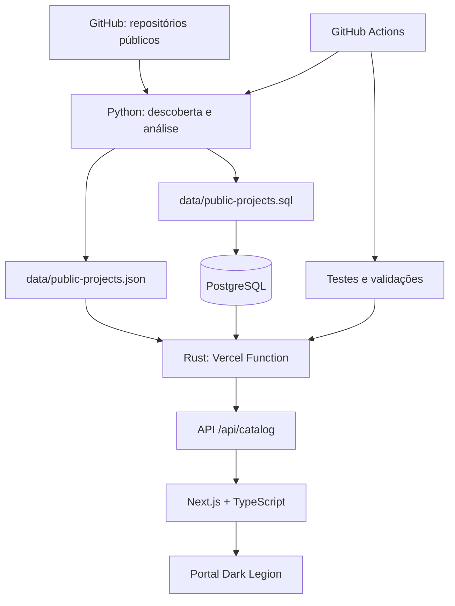

# Dark Legion

**Diretório público de projetos e demonstração de engenharia de software em múltiplas camadas.**

O Dark Legion reúne os repositórios e aplicações públicas do ecossistema, oferecendo um catálogo pesquisável e uma arquitetura que combina frontend TypeScript, APIs Rust, automação Python e persistência PostgreSQL.

> O portal publica somente informações de repositórios públicos. Projetos privados não são enumerados nem têm nomes, arquivos, estrutura interna ou metadados divulgados.

## Visão geral

| Camada | Tecnologia | Responsabilidade |
|---|---|---|
| Portal | Next.js, React e TypeScript | Interface, pesquisa, filtros e páginas de projeto |
| API de produção | Rust + Vercel Functions | Entrega do catálogo e estado do serviço |
| API local | Rust + Axum + Tokio | Desenvolvimento e testes do contrato HTTP |
| Persistência | PostgreSQL + SQLx | Fonte de dados opcional em execução |
| Automação | Python | Descoberta de repositórios públicos e geração do catálogo |
| CI/CD | GitHub Actions + Vercel | Testes, análise agendada e publicação |

## Arquitetura

O frontend consome a API Rust pelo endpoint `/api/catalog`. A API consulta PostgreSQL quando `DATABASE_URL` está configurada e saudável; caso contrário, utiliza o snapshot JSON versionado para manter o portal disponível.



### Fluxo de dados

1. Os scripts Python consultam somente repositórios públicos do perfil configurado.
2. O catálogo JSON guarda os registros públicos e os metadados editoriais utilizados pelo portal.
3. O analisador gera um snapshot SQL reproduzível, com upsert e remoção de registros que deixaram de pertencer ao catálogo público.
4. GitHub Actions executa testes e valida se os arquivos gerados permanecem sincronizados.
5. Quando PostgreSQL está configurado, a API Rust consulta o banco; em caso de ausência ou indisponibilidade, responde com o JSON incorporado.
6. O frontend valida a estrutura da resposta antes de exibir os dados.

## Contratos HTTP

| Método | Endpoint | Descrição |
|---|---|---|
| `GET` | `/api/catalog` | Lista o catálogo e informa a fonte ativa |
| `GET` | `/api/health` | Estado da API, fonte do catálogo e contagem |
| `GET` | `/api/v1/projects` | Lista filtrável na API Axum local |
| `GET` | `/api/v1/projects/{slug}` | Consulta um projeto pelo identificador |
| `GET` | `/health` | Health check da API Axum local |

A API é somente leitura. Não existe endpoint público para cadastrar ou alterar projetos.

## Estrutura do repositório

```text
app/                 Portal Next.js e páginas de projeto
api/                 Rust Functions publicadas na Vercel
backend/              API Axum para desenvolvimento local
src/                  Biblioteca Rust compartilhada pelas Functions
data/                 Catálogo JSON e snapshot SQL
scripts/              Descoberta e análise do catálogo em Python
tests/                Testes de integração PostgreSQL
docs/                 Arquitetura, deploy e operação
.github/workflows/    CI e análises agendadas
```

## Executar localmente

### Requisitos

- Node.js 22
- Rust stable e Cargo
- Python 3.12 para os scripts de catálogo
- PostgreSQL somente para testar o modo conectado

### Portal

Na raiz do repositório:

```bash
npm install
npm run dev
```

Abra [http://localhost:3000](http://localhost:3000).

Verificações do frontend:

```bash
npm run lint
npm run typecheck
npm run build
```

### API Axum local

Em outro terminal:

```bash
cd backend
cargo run
```

A API local usa o catálogo JSON quando não recebe `DATABASE_URL`. Para conectar PostgreSQL, configure a variável no ambiente local sem adicioná-la ao Git.

### API Rust da Vercel

Na raiz:

```bash
cargo fmt --all -- --check
cargo check --bins
cargo test --all-targets
```

## Qualidade e automação

Os workflows separam as responsabilidades:

- **Frontend:** ESLint, verificação de tipos TypeScript e build Next.js.
- **Rust API:** rustfmt, Clippy, testes das APIs Axum e Vercel Functions.
- **PostgreSQL:** sobe um banco temporário, aplica o snapshot, insere um registro obsoleto e verifica que a sincronização o remove.
- **Catálogo:** testa descoberta pública, valida os scripts Python e confirma que o SQL gerado corresponde ao JSON.
- **Higiene do repositório:** impede que diretórios de build e cache como `.next/`, `target/`, `node_modules/` e `.vercel/` sejam versionados.

As análises agendadas do catálogo estão configuradas para 14h e 00h no horário de Brasília.

## Configuração de ambiente

| Variável | Uso |
|---|---|
| `DATABASE_URL` | Conexão privada com PostgreSQL para a API e sincronização |
| `NEXT_PUBLIC_DARK_LEGION_API_URL` | URL opcional da API; por padrão, o frontend usa a origem atual |
| `FRONTEND_ORIGIN` | Origem permitida pelo CORS da API Axum local |

Configure valores sensíveis diretamente nos ambientes protegidos da Vercel ou nos GitHub Actions Secrets. Nunca grave credenciais em arquivos versionados, Issues ou logs. Os arquivos `.env.example` documentam somente nomes e exemplos não sensíveis.

## Segurança e limites

- Somente repositórios públicos podem entrar no catálogo.
- O catálogo não deve conter nomes ou metadados de projetos privados.
- A API de produção é somente leitura.
- URLs de repositórios e aplicações precisam ser HTTPS.
- O snapshot JSON é o fallback operacional; PostgreSQL é opcional, não um pré-requisito para servir o portal.
- A presença de uma URL no catálogo é uma decisão editorial; não significa monitoramento contínuo da disponibilidade externa.

## Documentação

- [Arquitetura e fluxo de dados](docs/architecture.md)
- [Configuração de deploy na Vercel](docs/deployment.md)
- [Catálogo público e critérios](docs/public-sites-catalog.md)
- [Análises agendadas](docs/scheduled-catalog-analysis.md)

---

**Dark Legion** — um projeto para demonstrar organização, integração, automação, qualidade e evolução de sistemas reais.
